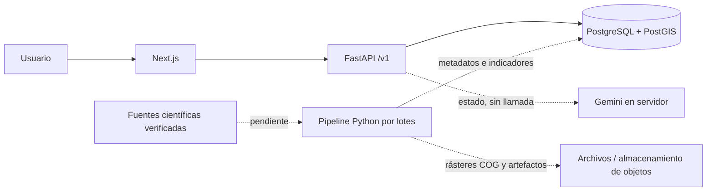

# Arquitectura

## Objetivo y límites

Separar presentación, contratos HTTP, persistencia y cálculo científico.
La API entrega evidencia calculada y trazable; no ejecuta descargas satelitales
ni entrenamiento dentro de una petición HTTP. `GET /v1/assistant` solo informa
el presupuesto: no llama a Gemini ni calcula métricas.

Líneas continuas: base implementada. Líneas discontinuas: componentes planificados.

## Responsabilidades

| Área | Responsabilidad |
| --- | --- |
| `apps/web/src/app` | Composición de páginas y estados de interfaz |
| `apps/web/src/lib` | Adaptadores de comunicación; llamadas internas solo desde servidor |
| `services/api/src/cocha_api/routes` | HTTP, validación de entrada y respuestas |
| `services/api/src/cocha_api/schemas` | Contratos públicos Pydantic |
| `services/api/src/cocha_api/db` | ORM, sesiones y conexiones |
| `services/api/src/cocha_api/core` | Configuración y logs |
| `services/api/migrations` | Historial del esquema administrado por Alembic |
| `services/workers` | Ejecutor local de QA; orquestación distribuida pendiente |
| `packages/shared` | Contratos generados, sin lógica científica duplicada |

El catálogo inicial es pequeño: las rutas consultan SQLAlchemy directamente.
Introducir servicios de aplicación y repositorios cuando aparezcan reglas de
dominio reutilizables; evitar capas sin responsabilidad real.

## Decisiones

El primer MVP añade una persistencia de evidencia basada en snapshots JSON
validados por Pydantic: el lote científico escribe `data/processed/explorer.json`
y `/v1/explorer` lo lee sin procesar rásteres en HTTP. Es un paso incremental
para el piloto sin límites distritales. No inserta resultados en el catálogo
PostGIS ni sustituye sus migraciones; la persistencia distrital se incorpora
cuando existan geometrías verificadas. Compose monta los snapshots en solo lectura.

1. **Monorepo:** npm workspaces para web y tipos; proyecto Python en la raíz.
2. **Contrato generado:** FastAPI genera OpenAPI y openapi-typescript genera tipos.
3. **Esquema versionado:** Alembic, sin `create_all` al iniciar la API.
4. **Rásteres fuera del ORM:** almacenar COG/Parquet y registrar URI, checksum y
   procedencia en una futura migración. PostGIS conserva geometrías e indicadores.
5. **Arranque explícito:** `migrate` termina antes de que arranque la API.
6. **Procesamiento diferido:** iniciar por scripts por lotes; Celery/Redis se
   incorporan cuando existan trabajos largos solicitados por usuarios.
7. **Dependencias mínimas:** MapLibre, deck.gl, Tailwind, bibliotecas científicas
   y Gemini se añaden junto con su funcionalidad y validación correspondientes.
8. **Sin datos de muestra ambiguos:** catálogo vacío hasta verificar fuentes.

El override de minimatch en la herramienta de lint evita GHSA-g3hv-75wg-m249.
Revisarlo al actualizar typescript-eslint; no es dependencia del runtime web.

## Contratos actuales

Ampliaciones pendientes de pruebas: `/v1/stations/{station_id}/observations`
expone registros PM10 solo si `MONICA_REVIEW_ENABLED` está habilitado; responde
con `scope=imported_records_review`, análisis desactivado y paginación `has_more`.
`/v1/jobs` ordena del más reciente al más antiguo y también informa `has_more`.
La web añade `/procesamiento` y `/estaciones/[id]`. La lectura guiada de
`/asistente` usa campos ya publicados y texto fijo, sin proveedor de IA.

| Método | Ruta | Comportamiento |
| --- | --- | --- |
| GET | `/health/live` | Proceso HTTP disponible; no consulta DB |
| GET | `/health/ready` | Comprueba PostGIS y revisión Alembic vigente; 503 ante fallo o revisión distinta |
| GET | `/v1/datasets?limit=50&offset=0` | Catálogo persistido; limit entre 1 y 100 |
| GET | `/openapi.json` | Contrato generado |
| GET | `/v1/explorer` | Snapshot Landsat validado; estado vacío si falta, 503 si es inválido |
| GET | `/v1/territories` | Piloto disponible; capas WMS según clave; `vector_districts` refleja el catálogo oficial en PostGIS (`available` con 15 polígonos `gamc-official-*`) |
| GET | `/v1/indicators?scene_id=...&limit=100` | Solo medias sintéticas sobre `demo-synthetic-v1`; `unavailable` sin demo (aunque el vector oficial exista). Indicadores oficiales van en `/v1/series`. Una adquisición por respuesta (`selected_scene_id`); escena inexistente → 404 |
| GET | `/v1/territories/districts` | Versiones territoriales oficiales (excluye demo), paginadas, GeoJSON opcional; `unavailable` sin vector importado; con varias versiones exige `boundary_version` |
| GET | `/v1/series` | `official_items` solo de `district_indicators` aceptados sobre versiones oficiales, con filtros de versión, distrito, variable, estadístico y período; `unavailable` si no hay ninguna fila aceptada |
| GET | `/v1/trends` | `official_trends` solo si hay `trend_results` aceptados; si no, `unavailable`. `pilot_trends` y `demo_trends` siguen descriptivos sin inferencia |
| GET | `/v1/models` | `accepted_models` con versión, incertidumbre y dominio si hay modelos aceptados; si no, `unavailable` con nota de viabilidad |
| GET | `/v1/scenarios` | `unavailable` con blockers; sin escenarios evaluados |
| GET | `/v1/jobs?kind=&status=` | Lectura de `processing_runs` con intento, latido y código de error, o `empty`; `GET /v1/jobs/{id}` responde 404 si no existe |
| GET | `/v1/stations/{id}/observations` | Revisión de registros con `MONICA_REVIEW_ENABLED` y rol `reviewer`; filtros por flag y fecha naive; conserva `observed_at_raw` |
| POST | `/v1/assistant/ask` | Rol `assistant`; `unavailable` mientras `GEMINI_CALLS_ENABLED=false`; con autorización: evidencia citada, límites, caché, cuota y ledger central |
| GET | `/v1/reports` | Informes formales `unavailable`. Si hay snapshot, `observation_export` es la ventana piloto, no un informe distrital |
| GET | `/v1/assistant` | Estado de presupuesto; no llama a Gemini; precios verificados el 14/11/2026 y llamadas apagadas; la clave no sale en la respuesta |
| GET | `/v1/stations` | Estaciones DB si existen; si no, perfil vacío con metadatos pendientes |
| GET | `/v1/gamc/wms/map`, `/legend`, `/feature-info` | Proxy WMS servidor; 503 sin clave; allowlist; límite de tasa en memoria; la clave no sale en la respuesta |

Cada recurso de dominio incluye un sobre de disponibilidad
(`available` \| `empty` \| `unavailable` y `reason` opcional). No se inventan
mediciones. Readiness no garantiza calidad científica.
El único POST bajo `/v1` es `/v1/assistant/ask`, protegido por el rol
`assistant` y pensado para llamarse desde el servidor web; CORS sigue limitado
a GET. Los roles (`core/auth.py`) son secretos compartidos por capacidad, no
cuentas de usuario. `GET /v1/assistant` informa el presupuesto y no llama a Gemini. El modelo `gemini-3.6-flash` y las
tarifas 0.75/3.75 USD por millón de tokens (hasta 2026-12-31) se contrastaron
el 14/11/2026; una llamada real sigue exigiendo autorización explícita.
La ingesta multitemporal sigue fuera de HTTP. La ventana piloto y los
rectángulos demo no sustituyen distritos municipales.

## Transacciones de importación y presupuesto

La lectura del snapshot del explorador se comparte con las rutas de dominio.
Una caché local acotada a cuatro revisiones evita releer y validar JSON sin
cambios; se invalida por modificación, tamaño e identidad del archivo. Cada
consumidor recibe una copia independiente. Archivos ausentes o inválidos no
recuperan silenciosamente evidencia antigua. La publicación debe reemplazar
el snapshot atómicamente. Esta optimización está pendiente de pruebas.

MÓNICA registra la ejecución en una transacción independiente e importa todos
sus archivos en otra. Un fallo revierte los datos y actualiza la auditoría desde
una sesión nueva. Las observaciones existentes son inmutables al reimportar;
ver `docs/monica-status.md` para duplicados y correcciones del proveedor.

El prototipo `BudgetLedger` conserva su JSON local y usa un archivo `.lock`
estable: bloqueo del sistema operativo, recarga, operación y reemplazo atómico
ocurren juntos. Funciona entre procesos que comparten el mismo disco en Windows
y Linux. No borrar el lock durante la ejecución ni usar copias independientes
del ledger. Un despliegue con varios hosts o sistemas de archivos de red exige
un almacén transaccional central antes de habilitar gasto. Sin `path`, el ledger
es solo memoria de una instancia. Esto no activa llamadas reales a Gemini.

El almacén central ya existe: `CentralBudgetLedger` (`science/gemini.py`) usa la
tabla `assistant_requests` y un `pg_advisory_xact_lock` común a todos los hosts.
Reserva antes de llamar, concilia con los tokens informados (o cobra la reserva
completa si el costo es desconocido) y guarda la respuesta para que repetir un
`request_id` la reproduzca sin pagar dos veces. El ledger JSON queda para el
estado local cuando las llamadas están apagadas.

## Ciclo de vida de trabajos

`cocha_api/jobs.py` gestiona `processing_runs` sin cola: `start_run` reclama
una clave de idempotencia y confirma la decisión antes de trabajar
(`started`, `retrying`, `already_completed`, `already_running`, `exhausted`);
`heartbeat` y `finish_run` registran el avance; `recover_stale` marca como
`interrupted` los trabajos sin latido; `publish_file` publica artefactos con
enlace duro, sin sobrescribir uno distinto. No se añadió una cola: los procesos
son lotes offline lanzados por un operador, y la necesidad no está demostrada.

## Referencias de implementación

- https://nextjs.org/docs/app/getting-started/installation
- https://fastapi.tiangolo.com/deployment/docker/
- https://docs.docker.com/compose/how-tos/use-secrets/
