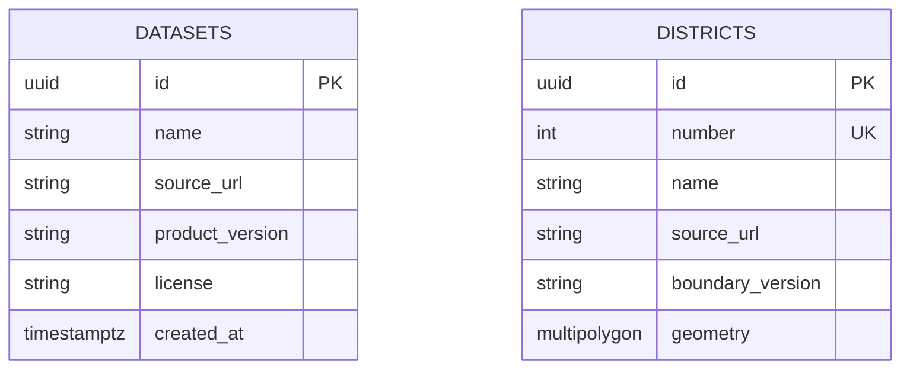

# Modelo de datos

## Implementado: migración 0001



- UUID se genera en la aplicación; fecha de alta en la base.
- Geometrías MULTIPOLYGON en EPSG:4326 con índice espacial GiST.
- Número distrital único entre 1 y 15. El límite proviene del alcance del
  proyecto; no significa que las geometrías ya estén verificadas.
- No hay seed automático ni API de escritura. Registrar fuentes tras revisarlas.
- Validar geometrías, licencias y URL al implementar la futura ingesta.

## Próximas entidades: diseño, todavía sin tablas

| Entidad | Campos esenciales |
| --- | --- |
| `processing_runs` | UUID, commit, parámetros, versión del entorno, estado y fechas |
| `assets` | dataset_id, URI, SHA-256, adquisición, CRS, resolución, unidades y máscara QA |
| `stations` | Identificador de fuente, coordenadas, elevación y metadatos del sensor |
| `observations` | estación, variable, unidad, tiempo UTC, valor y calidad |
| `district_indicators` | distrito y versión del límite, variable, período, estadístico, valor, cobertura válida, n y processing_run_id |
| `trend_results` | serie, método, pendiente, unidades, intervalo, p, p ajustado e hipótesis |
| `model_runs` | objetivo, variables, partición de validación, métricas, artefacto y procedencia |
| `scenario_runs` | modelo, supuestos, intervención, resultado e incertidumbre |

Indicadores deben referenciar el límite territorial utilizado; si cambian los
límites, conservar versiones históricas antes de comparar. Definir restricciones
de unicidad por variable/período/territorio/ejecución para evitar duplicados.
No mezclar observaciones, estimaciones y escenarios en una misma serie sin
identificación explícita de su naturaleza.

## Migraciones

```powershell
uv run alembic revision --autogenerate -m "describe schema change"
# Revisar el archivo generado antes de aplicarlo.
uv run alembic upgrade head
uv run alembic check
```

PostGIS debe estar instalado por la infraestructura. El usuario de aplicación
no debería crear extensiones en producción. Alembic solo administra las tablas
de la aplicación, no el catálogo interno de PostGIS.
