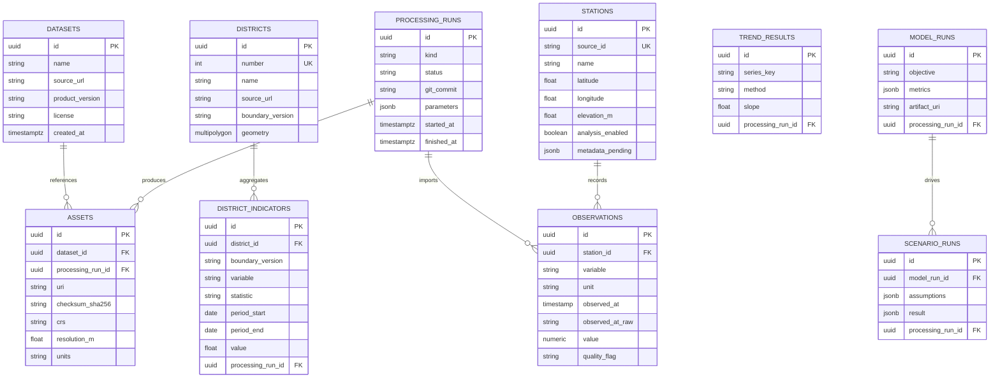

# Modelo de datos

## Implementado: migraciones 0001 y 0002



### 0001 — catálogo territorial

- UUID se genera en la aplicación; fecha de alta en la base.
- Geometrías MULTIPOLYGON en EPSG:4326 con índice espacial GiST.
- Número distrital único entre 1 y 15. El límite proviene del alcance del
  proyecto; no significa que las geometrías ya estén verificadas.
- No hay seed automático ni API de escritura pública.

### 0002 — persistencia científica

- `processing_runs`: procedencia de lotes (parámetros, entorno, estado).
- `assets`: URI + SHA-256 de rásteres/artefactos; sin blobs en la base.
- `stations`: coordenadas y elevación nullable (MÓNICA aún sin coords oficiales).
- `observations`: unicidad `(station_id, variable, observed_at)`; `observed_at`
  es timestamp naive porque los CSV no declaran zona horaria; no etiquetar UTC.
  `unit` puede guardarse como `ug/m3` cuando la importación usa la declaración
  del informe Red MoniCA citado en el catálogo; el encabezado del CSV no trae
  unidad. No inventar huso ni coordenadas. `quality_flag` distingue valid/zero/
  negative/invalid/duplicate.
- `district_indicators`, `trend_results`, `model_runs`, `scenario_runs`: tablas
  listas para A06–A12; todavía sin cálculos poblados por la API.
- `analysis_enabled` en estaciones permanece en `false` mientras falten huso,
  coordenadas, códigos de calidad y licencia. La unidad declarada no basta
  para activar agregados.

### 0003 — publicación y ciclo de vida (pendiente de probar)

- `districts`: unicidad por `(boundary_version, number)` en lugar de solo
  `number`, para que los rectángulos demo y cada versión oficial convivan. El
  importador demo solo toca filas `demo-synthetic-v1`.
- `district_indicators`, `trend_results`, `model_runs`, `scenario_runs`:
  `publication_status` (`draft` por defecto, `accepted`, `withdrawn`),
  `accepted_by`, `accepted_at`. La API solo publica filas `accepted`.
- `district_indicators.provenance` (producto, versión, máscara QA, resolución,
  CRS) y unicidad con `NULLS NOT DISTINCT`: sin `processing_run_id` ya no se
  pueden duplicar filas en silencio.
- `model_runs`: `model_version`, `uncertainty`, `domain_of_use`; un modelo
  `accepted` sin ellos ni checksum es rechazado por la base.
- `processing_runs`: `idempotency_key` única, `attempt`, `heartbeat_at`,
  `error_code`.
- `assistant_requests`: ledger central del presupuesto Gemini.

Cargar y aceptar resultados:

```powershell
uv run python scripts/load_district_indicators.py entrega.jsonl --dry-run
uv run python scripts/load_district_indicators.py entrega.jsonl
uv run python scripts/publish_results.py district_indicators --processing-run-id <uuid> --accepted-by "Mateo"
```

Indicadores deben referenciar el límite territorial utilizado; si cambian los
límites, conservar versiones históricas antes de comparar. No mezclar
observaciones, estimaciones y escenarios sin identificación explícita.

## Migraciones

```powershell
uv run alembic revision --autogenerate -m "describe schema change"
# Revisar el archivo generado antes de aplicarlo.
uv run alembic upgrade head
uv run alembic check
```

PostGIS debe estar instalado por la infraestructura. El usuario de aplicación
no debería crear extensiones en producción. Alembic solo administra las tablas
de la aplicación, no el catálogo interno de PostGIS. Readiness compara la
revisión instalada con el head de Alembic (`0003` tras esta entrega).
