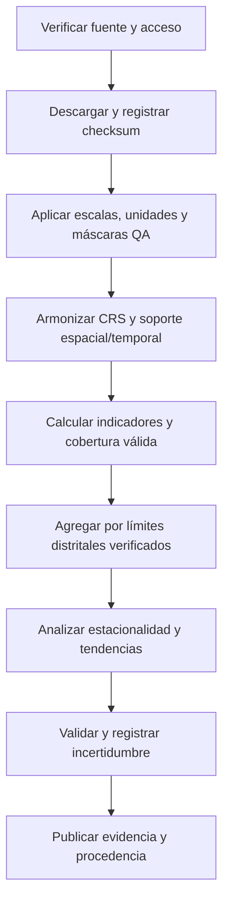

# Plan científico y política de evidencia

## Estado

El piloto descarga ventanas reales Landsat C2 L2 mediante Planetary Computer,
aplica escalas USGS y una máscara QA compartida para LST/NDVI. Ver `docs/mvp.md`
para alcance y limitaciones. MODIS sigue pendiente. MÓNICA tiene PM10 con unidad
declarada desde un informe y sin huso ni coordenadas (`docs/monica-status.md`).
El vector distrital GAMC sigue bloqueado; el fixture demo no lo sustituye.

| Fuente | Uso candidato | Verificación pendiente |
| --- | --- | --- |
| Landsat Collection 2 Level-2 | LST y NDVI a partir de reflectancia | Cobertura local, QA, escala, nubes, huecos y acceso |
| MODIS | Contexto temporal de mayor frecuencia | Producto y versión exactos, resolución y cobertura distrital |
| Red MÓNICA | PM10 de Kanata y Semapa | Huso, coordenadas, calidad de ceros/negativos y licencia; unidad declarada aparte |
| GAMC | Límites de los distritos | Fuente oficial, versión, CRS y permiso de uso |

No usar temperatura superficial como equivalente a temperatura del aire.
No remuestrear un producto para afirmar que tiene una resolución física mayor.
No asumir que MÓNICA mide todas las variables necesarias para calibrar LST.

## Pipeline futuro

Cada ejecución debe fijar período, área de estudio, productos/versiones,
parámetros, commit y entorno. Rásteres originales inmutables; procesamiento
idempotente con checksum y manifiesto. Reintentos no deben duplicar indicadores.

## Análisis y aprendizaje automático

- Definir la variable objetivo antes de entrenar.
- Comparar temporadas equivalentes; registrar sesgo por nubosidad y datos faltantes.
- Mostrar pendiente, intervalo, tamaño de muestra y cobertura válida.
- Evaluar autocorrelación y ajustar comparaciones múltiples cuando corresponda.
- Reportar asociación LST–NDVI sin atribuir causalidad automáticamente.
- Comparar baseline con un modelo adicional solo con datos suficientes.
- Validar por bloques espaciales y temporales; ajustar transformaciones usando
  únicamente entrenamiento. Evitar fuga entre píxeles vecinos o fechas futuras.
- Mostrar MAE/RMSE en unidades del objetivo y evaluar cobertura de intervalos.
- Distinguir observaciones, estimaciones y escenarios en API y gráficos.

## Recursos

- Reto: https://www.spaceappschallenge.org/2026/challenges/earth-system-trend-detective/
- Enfoque local: https://spaceappschallenge-cbba.com/#retos
- Portal municipal: https://recursosgamc.cochabamba.bo/
- Producto LST: https://www.usgs.gov/landsat-missions/landsat-collection-2-surface-temperature

La revisión del 14 de noviembre de 2026 confirmó y descargó los CSV MÓNICA de
Kanata/Semapa con PM10 y fechas sin zona horaria. La unidad µg/m³ se declara
desde un informe oficial, no desde el CSV. El catálogo GAMC anuncia límites
distritales WMS, pero todavía no se obtuvo un vector completo. Ver
`docs/gamc-resources.md`, `docs/monica-status.md` y `data/catalog/gamc.json`.
La descarga no equivale a validación ni calibración de LST. Confirmar criterios
oficiales antes de presentar; el stack es una decisión del proyecto.
